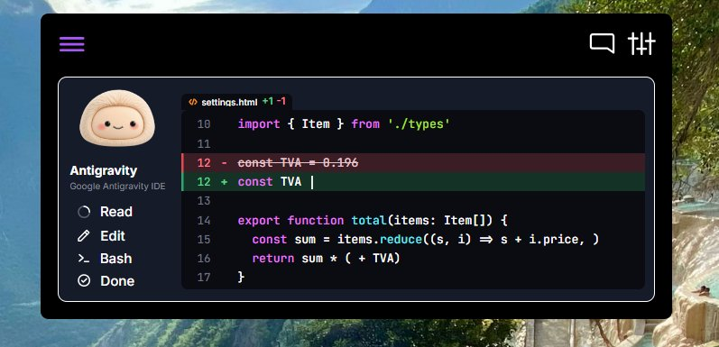
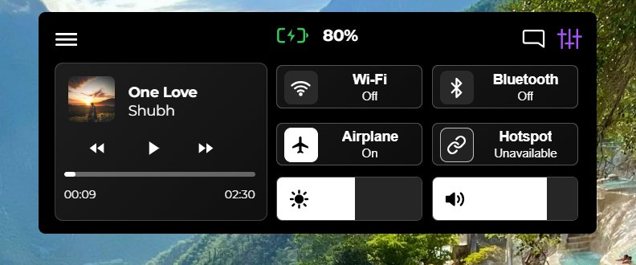
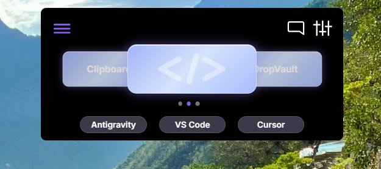
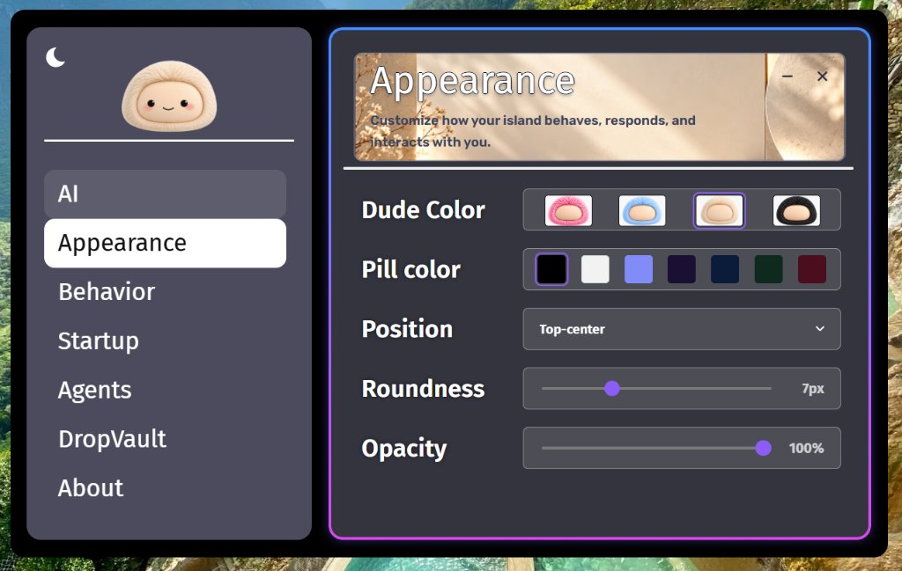
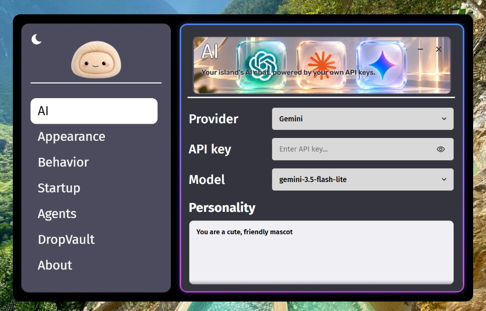

<p align="center">
  
</p>

<h1 align="center">Dude 2.0</h1>

<p align="center">
  <strong>Your intelligent, expressive desktop companion and coding copilot for Windows.</strong>
  <br>
  An animated desktop mascot, Gemini AI assistant, laptop controls, DropVault, and real-time coding-agent activity in one sleek floating widget.
</p>

<p align="center">
  <a href="https://github.com/shubham7-dev/Dude/releases/latest"></a>
  <a href="https://github.com/shubham7-dev/Dude/blob/main/LICENSE"></a>
  <a href="https://tauri.app/"></a>
  <a href="https://www.rust-lang.org/"></a>
  <a href="https://deepmind.google/technologies/gemini/"></a>
  
</p>

<p align="center">
  <a href="#download--releases"><strong>Download</strong></a> ·
  <a href="#features-at-a-glance">Features</a> ·
  <a href="#screenshots--walkthrough">Screenshots</a> ·
  <a href="#installation--setup">Installation</a> ·
  <a href="#keyboard-shortcuts">Shortcuts</a> ·
  <a href="#privacy--security">Privacy</a> ·
  <a href="#build-from-source">Build</a> ·
  <a href="https://github.com/shubham7-dev/Dude/issues">Report Bug</a>
</p>

---

## Overview

**Dude** is an ultra-compact, high-performance desktop companion built for Windows 11. Anchored gracefully at the top edge of your screen, Dude combines an interactive animated mascot with everyday productivity superpowers: instant conversational AI, one-click laptop hardware controls, seamless drag-and-drop file staging, and live streaming visualization of your coding agents (Antigravity, Claude Code, Cursor).

Engineered with **Tauri 2, Rust, TypeScript, and Vite**, Dude operates with near-zero idle resource consumption while maintaining native OS responsiveness.

---

## Visual Showcase

<div align="center">

### 1. 🛠️ Live Coding Agents & Real-Time Diff Viewer

<p><em>Real-time visualization of agent turn progress (Read, Edit, Bash, Done) with inline line-numbered color-coded code diff streaming for Antigravity, Claude Code, and Cursor.</em></p>

<br>

### 2. ⚡ Quick Laptop Controls & Media Center

<p><em>Integrated media player with live track info and album art alongside instant toggles for Wi-Fi, Bluetooth, Airplane Mode, Mobile Hotspot, Brightness, Volume, and real-time battery status.</em></p>

<br>

### 3. 🎯 Hub Carousel & IDE Switcher

<p><em>Swipeable 3D card carousel navigating between Clipboard History, Agents Code Diff, and DropVault, with one-click direct launchers for Antigravity, VS Code, and Cursor.</em></p>

<br>

### 4. 🎨 Appearance & Island Customization

<p><em>Full aesthetic control: 4 collectible mascot colorways (Pink, Blue, Cream, Black), pill color palettes, corner roundness sliders, window opacity, and multi-monitor screen position presets.</em></p>

<br>

### 5. 🤖 Gemini AI Assistant & Credential Setup

<p><em>Instant connectivity to Google AI Studio with custom persona prompts, model selection (gemini-3.5-flash-lite), and encrypted Windows Credential Manager storage for your personal API key.</em></p>

</div>

---

## Features at a Glance

### 🤖 Animated Desktop Companion
- **Living Character Engine**: Expressive states including idle blinking, curious eye-tracking following your cursor, smiling, thinking, speaking, and sleeping.
- **Color Personalities**: Four collectible body themes — **Cream (Classic)**, **Blush Pink**, **Sky Blue**, and **Midnight Black**.
- **Adaptive Floating Pill**: Smoothly expands on hover or click; customizable roundness, background opacity, blur, and placement presets (Top Center, Top Left, Top Right, or custom X/Y coordinates).
- **Audio Expressions**: Procedural, ultra-low-latency chimes and ambient reaction audio powered by a native Rust audio engine.

---

### 💬 Intelligent Gemini AI Assistant
- **Gemini 3.5 & Flash Models**: Directly connected to Google AI Studio with models optimized for instant chat responses (`gemini-3.5-flash`, `gemini-3.5-flash-lite`, `gemini-3-flash-preview`).
- **Conversational Memory**: Multi-turn dialog context with token-efficient history pruning.
- **Custom Personas**: Tailor Dude's personality, tone, and system prompt directly in Settings.
- **Enterprise-Grade Key Safety**: Your personal Gemini API key is encrypted and stored exclusively in **Windows Credential Manager** — never in plain text, logs, or cloud servers.

---

### 🛠️ Live Coding Agents Integration
- **Real-Time Agent Telemetry**: Seamless IPC listener via local Windows Named Pipe (`\\.\pipe\dude-agent-events`).
- **Universal Agent Support**: Official zero-latency hook bridges for **Google Antigravity**, **Claude Code**, and **Cursor**.
- **Dynamic Lifecycle Steps**: Real-time visual progress across every stage:
  - 🟢 **Read**: Active during file reads, glob searches, codebase greps, and documentation queries.
  - ✏️ **Edit**: Live diff streaming during file rewrites, insertions, and multi-line edits.
  - 💻 **Bash**: Terminal command executions with live command-line display and exit code badges.
  - ✅ **Done**: Turn completion status with celebration mascot feedback.
- **Multi-Tab File Diff Viewer**:
  - Independent tabs for every modified file during the current turn.
  - Color-coded diff syntax highlighting (`+` additions in green, `-` deletions in red).
  - Accurate line numbering grounded in disk content.
  - Pinning support with 10-second inspection hold and an instant **"Latest"** auto-follow jump button.
- **Interactive Tool Approval**: Review, inspect, and approve/deny agent commands (`run_command`, terminal tasks) directly from the floating widget.

---

### 📁 DropVault with Native OS Drag-Out
- **Desktop Drop Target**: Drop any file onto the floating island to safely store it in your local `Documents\DropVault` folder.
- **True OS Drag-Out (`tauri-plugin-drag`)**: Drag any card from DropVault directly into **Windows Explorer**, **Desktop**, **VS Code**, **browser upload zones**, **Discord**, **Slack**, or Dude's Chat panel.
- **Smart Click vs. Drag Gesture**:
  - Single click -> opens/reveals the file in default Windows app or Explorer.
  - Drag (> 6px movement) -> initiates Win32 OLE `DoDragDrop` (`CF_HDROP`) without accidental opening.
- **Safe Inspection**: Executable files are blocked from direct accidental launch and revealed in Explorer instead.
- **One-Click Cleanup**: Move files older than your chosen threshold directly to Windows Recycle Bin.

---

### ⚡ Quick Laptop Control Center
- **Media Controller**: Live Windows System Media Transport Controls (SMTC) integration featuring track title, artist, album art, play/pause, seek slider, and skip track buttons.
- **Display Brightness**: Smooth hardware display brightness slider via Windows WMI CIM.
- **Audio & Mute**: High-precision master volume slider and one-click mute.
- **Battery Hub**: Real-time battery percentage, AC power connection status, and Windows Battery Saver toggle.
- **Connectivity Radios**: Instant toggles for Wi-Fi (with current SSID), Bluetooth, Airplane Mode, and Mobile Hotspot.
- **Quick System Actions**: Lock Workstation, Sleep, launch Windows Snipping Tool (`ms-screenclip:`), and toggle Windows Dark/Light theme.

---

### 📋 Private Clipboard History
- **In-Memory Only**: Kept in volatile RAM and automatically cleared upon exiting Dude.
- **Secret Redaction**: Passwords, API tokens, and entries originating from password managers (1Password, Bitwarden, KeePass) are automatically ignored.

---

## Keyboard Shortcuts

| Shortcut | Action | Scope |
| :--- | :--- | :--- |
| <kbd>Ctrl</kbd> + <kbd>Shift</kbd> + <kbd>M</kbd> | Toggle Mascot widget visibility | Global |
| <kbd>Ctrl</kbd> + <kbd>Shift</kbd> + <kbd>Space</kbd> | Open / Focus Gemini AI Chat drawer | Global |
| <kbd>Esc</kbd> | Collapse active panel or dismiss drawer | In-App |
| <kbd>Enter</kbd> | Open selected DropVault file / Send Chat prompt | In-App |
| <kbd>D</kbd> | Cycle Agent Steps Demo (Debug builds) | Mascot Focus |
| <kbd>L</kbd> | Run Multi-Tab Diff 14-File Self Audit (Debug builds) | Mascot Focus |

---

## Download & Releases

Dude is distributed as both an automated NSIS installer and a standalone MSI package:

| Version | Release Date | Highlights | Download Link |
| :--- | :--- | :--- | :--- |
| **v0.3.2** (Latest) | *Current* | Per-file multi-tab diff view, real-time agent lifecycle steps (Read/Edit/Bash/Done), native OS drag-out for DropVault | [Release v0.3.2](https://github.com/shubham7-dev/Dude/releases/tag/v0.3.2) |
| **v0.3.1** | 2026-10-25 | Gemini 3.5 Flash upgrade, high-res icon set, Claude Code v0.2 hook compatibility | [Release v0.3.1](https://github.com/shubham7-dev/Dude/releases/tag/v0.3.1) |
| **v0.3.0** | 2026-10-21 | Compact approval cards, Claude Code / Gemini Code Assist integration | [Release v0.3.0](https://github.com/shubham7-dev/Dude/releases/tag/v0.3.0) |
| **v0.2.0** | 2026-10-18 | Standalone `dude-hook.exe`, Named Pipe IPC, tool decision approvals | [Release v0.2.0](https://github.com/shubham7-dev/Dude/releases/tag/v0.2.0) |
| **v0.1.0** | 2026-10-17 | Initial public release: animated mascot, Gemini chat, laptop controls | [Release v0.1.0](https://github.com/shubham7-dev/Dude/releases/tag/v0.1.0) |

Full changelog history is maintained in [CHANGELOG.md](CHANGELOG.md).

---

## Installation & Setup

### Requirements
- **Operating System:** Windows 11 (64-bit).
- **Runtime:** Microsoft Edge WebView2 (pre-installed by default on Windows 11).

### Setup Instructions
1. Download the latest installer from the [Releases page](https://github.com/shubham7-dev/Dude/releases/latest) (`Dude_0.3.2_x64-setup.exe`).
2. Run the installer and launch Dude.
3. **Configure AI Assistant**:
   - Get a free API key at [Google AI Studio](https://aistudio.google.com/apikey).
   - In Dude, click the settings icon or right-click the mascot -> **Settings → AI**.
   - Paste your API key and click **Test & Save**.
4. **Connect Coding Agents**:
   - In **Settings → Agents**, click **Install** under Antigravity / Claude Code.
   - Dude automatically configures the lifecycle hook into your agent's config with timestamped backups.

### Cryptographic Checksum Verification
To verify the integrity of your installer package:
```powershell
Get-FileHash .\Dude_0.3.2_x64-setup.exe -Algorithm SHA256
```
Compare the resulting hash with the corresponding entry in `SHA256SUMS`.

> [!NOTE]
> **Windows SmartScreen Note**: Because Dude is an independent open-source project without an enterprise EV code-signing certificate, Windows SmartScreen may display an initial prompt. Click *"More info"* -> *"Run anyway"* to proceed. The complete source code is public and fully auditable here.

---

## Privacy & Security

Dude is engineered around a **strict local-first, zero-telemetry philosophy**:

- 🔒 **Zero Telemetry**: No analytics, tracking pixels, or diagnostic reporting. Dude never phones home.
- 🔑 **Encrypted Credentials**: Your Gemini API key is stored in the Windows Credential Manager (`wincred`), never on disk in plain text.
- 💻 **Air-Gapped Controls**: Media, brightness, volume, and battery queries execute purely via local Win32 and WMI CIM APIs.
- 📝 **Volatile Clipboard**: Clipboard history is kept in volatile RAM only and discarded upon exit; sensitive clipboard data (passwords, crypto keys) is automatically filtered out.
- 📁 **Isolated Storage**: DropVault operates strictly inside `Documents\DropVault` (or your user-configured directory). Files are only sent to the AI when you explicitly attach them.

Read our complete [Privacy Policy](docs/PRIVACY.md).

---

## Architecture

```
                  +-------------------------------------------------+
                  |                   DUDE WIDGET                   |
                  |  (Transparent, Always-On-Top, Floating Pill)   |
                  +-------------------------------------------------+
                                     |           |
            +------------------------+           +----------------------+
            |                                                           |
+-----------------------+                                   +-----------------------+
|    FRONTEND (Vite)    |                                   |    RUST CORE (Tauri)  |
|  - Animated Canvas    | <======== Tauri IPC Commands ===> |  - System Tray & Menu |
|  - Chat Drawer (MD)   |                                   |  - Win32 Audio & SMTC |
|  - Controls Panel     |                                   |  - WMI CIM Brightness |
|  - Agents Multi-Tab   |                                   |  - Windows Credential |
|  - DropVault Grid     |                                   |  - tauri-plugin-drag  |
+-----------------------+                                   +-----------------------+
                                                                        ^
                                                                        | Named Pipe IPC
                                                                        v
                                                            +-----------------------+
                                                            |     dude-hook.exe     |
                                                            | (Antigravity / Claude)|
                                                            +-----------------------+
```

For a comprehensive technical breakdown, see [docs/ARCHITECTURE.md](docs/ARCHITECTURE.md).

---

## Build from Source

### Prerequisites
- [Node.js](https://nodejs.org/) (v20+ recommended)
- [Rust](https://www.rust-lang.org/tools/install) (stable toolchain)
- Visual Studio Build Tools with **Desktop development with C++**
- `x86_64-pc-windows-msvc` target

### Build Steps

1. **Clone the repository**:
   ```powershell
   git clone https://github.com/shubham7-dev/Dude.git
   cd Dude
   ```

2. **Install frontend dependencies**:
   ```powershell
   npm install
   ```

3. **Run in development mode**:
   ```powershell
   npm run tauri dev
   ```

4. **Compile production release bundle**:
   ```powershell
   npm run tauri build
   ```
   Installers will be generated under `src-tauri/target/release/bundle/`.

5. **Run tests**:
   ```powershell
   cargo test --manifest-path src-tauri/Cargo.toml -- --test-threads=1
   ```

---

## Documentation Links

- 📖 [Contributing Guidelines](CONTRIBUTING.md) — PR guide, coding style, and testing requirements.
- 🏛️ [System Architecture](docs/ARCHITECTURE.md) — In-depth look at internal processes and Windows subsystems.
- 📦 [Release Guide](docs/RELEASE_GUIDE.md) — Release engineering and deployment instructions.
- 🔐 [Privacy Policy](docs/PRIVACY.md) — Comprehensive user privacy manifesto.

---

## Author & Credits

Designed and developed with ❤️ by **[Shubham Kale](https://github.com/shubham7-dev)**.

## License

- **Source Code**: Licensed under the [MIT License](LICENSE).
- **Artwork & Mascot Branding**: The name "Dude", character illustrations, 3D mascot renders, sound assets, and branded iconography are Copyright &copy; 2026 Shubham Kale. All Rights Reserved. See [LICENSE-ASSETS.md](LICENSE-ASSETS.md).

---

<p align="center">
  <sub>Dude · Made with care for a more delightful, productive Windows desktop.</sub>
</p>
