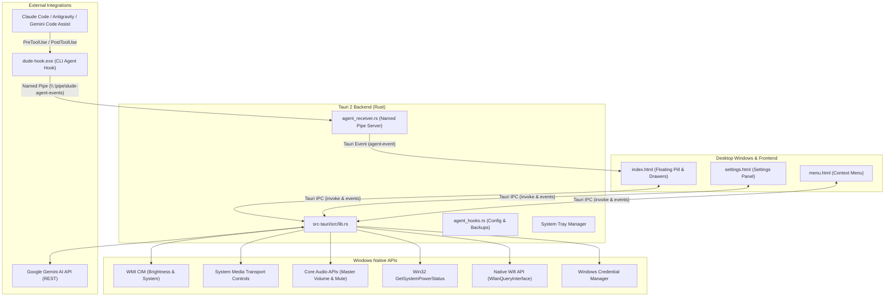

# Architecture of Dude

This document provides a technical overview of **Dude**, detailing its system design, multi-window layout, Windows platform integrations, AI engine, and Agent Hook inter-process communication (IPC).

---

## 1. System Overview

Dude is a native Windows desktop companion built on **Tauri 2**, combining a high-performance **Rust** system backend with an ultra-responsive **Web** frontend (HTML5, Vanilla CSS, TypeScript/JavaScript, Vite).

---

## 2. Multi-Page Frontend Architecture

Unlike single-page applications that manage popups via overlays, Dude uses separate OS-level windows managed by Tauri for optimal rendering isolation and performance:

1. **Floating Pill (`index.html`)**:
   - Frameless, transparent, always-on-top desktop widget.
   - Hosts the interactive mascot character canvas, live eye-tracking tracker, laptop control drawer, AI assistant chat drawer, and agent monitoring tab.
   - Dynamic hit-testing: ignores cursor events when collapsed, captures interactions when hovered or clicked.

2. **Settings Window (`settings.html`)**:
   - Standard decorated window for comprehensive application configuration.
   - Categorized into distinct tabs: AI Configuration, Appearance, Behavior, Windows Startup, Agents Integration, and About.
   - Supports independent Dark and Light themes with real-time UI preview.

3. **Desktop Context Menu (`menu.html`)**:
   - Lightweight, fast-opening popover appearing on right-click.
   - Provides instant actions: Settings, Hide/Show Companion, and Exit.

---

## 3. Windows Native Subsystems in Rust

The Tauri backend (`src-tauri/src/lib.rs`) communicates directly with Windows system APIs:

- **Display Brightness**: Managed via Windows Management Instrumentation (WMI) `WmiMonitorBrightnessMethods` and `WmiMonitorBrightness`.
- **Media Controls**: Integrated with Windows System Media Transport Controls (SMTC) via `windows::Media::Control::GlobalSystemMediaTransportControlsSessionManager`. Retrieves track title, artist, playback status, and embedded album art.
- **Audio Control**: Uses Windows Core Audio COM interfaces (`IAudioEndpointVolume`) for precision volume attenuation and master mute state.
- **Battery & Power**: Queried via Win32 `GetSystemPowerStatus` to expose charging state and battery percentage.
- **Network & Connectivity**: Uses `wlanapi.dll` (`WlanOpenHandle`, `WlanEnumInterfaces`, `WlanQueryInterface`) to inspect connected Wi-Fi SSIDs.

---

## 4. Google Gemini AI Engine

Dude integrates with Google AI Studio using the official Gemini REST endpoints:

- **Primary Model**: Upgraded to `gemini-3.5-flash` for low-latency (<1.5s) responses and high throughput.
- **Dynamic Model Discovery**: Queries the Gemini `models` catalog on demand to display supported models for the user's API tier.
- **Token Optimization**: Fast connection test requests use minimal token budgets (`maxOutputTokens: 5`) with strict 8-second timeouts.
- **Credential Storage**: User API keys are stored securely using Windows Credential Manager under the target `Dude_Gemini_ApiKey`.

---

## 5. Agent Hook & Named Pipe IPC

To observe and approve AI agent actions (e.g. in Antigravity or Claude Code):

1. **`dude-hook.exe`**:
   - A dedicated lightweight CLI binary built from `src-tauri/src/bin/dude-hook.rs`.
   - Registered in agent hook configurations (`hooks.json` or Claude Code settings).
   - Receives JSON payload via standard input upon agent tool events (e.g., `PreToolUse`, `PostToolUse`).
2. **Named Pipe Communication**:
   - Connects to the local server `\\.\pipe\dude-agent-events`.
   - Sends structured `AgentEvent` payloads to Dude.
   - Waits for interactive user approvals (Allow / Reject) when dangerous commands or file operations occur.
3. **Approval Flow**:
   - Dude's floating pill widget displays interactive approval cards with command snippets.
   - When the user clicks Allow or Deny, Dude responds through the pipe, and `dude-hook.exe` writes the permission decision back to the calling CLI agent.

---

## 6. Persistence & Configuration

- **General Settings**: Saved to `%APPDATA%\com.shubham7dev.dude\dude_settings.json` (pill position, colors, speeds, auto-start, model preferences).
- **Secure Credentials**: Stored in Windows Credential Manager.
- **Hook Configurations**: Safely backed up with timestamped copies (`hooks.json.bak.<timestamp>`) before automated modification.
